# hi!! <a href="https://darsh.app">darsh.app</a> · <code>ssh darsh.app</code>

i'm darsh, a grade 12 student in Mississauga who makes hardware: circuit boards, robots, drones and things that lights up. i co-lead [FraserHacks](https://fraserhacks.dev), run [Dayoneof](https://dayoneof.hackclub.com) and lead the [CS Club](https://cs.fraserhacks.dev).

  <a href="https://github.com/darshg321/Icey">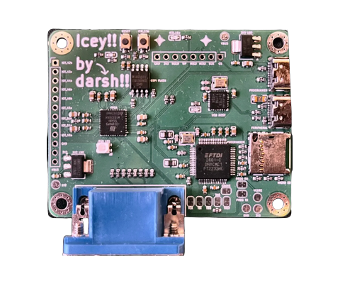</a>
  <a href="https://github.com/darshg321/Ultisense">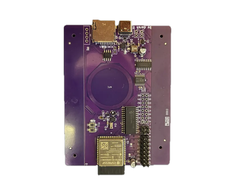</a>
  <a href="https://github.com/darshg321/arcadetris">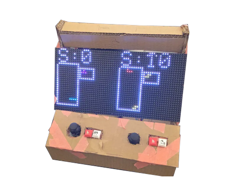</a>
  <a href="https://github.com/darshg321/Steady">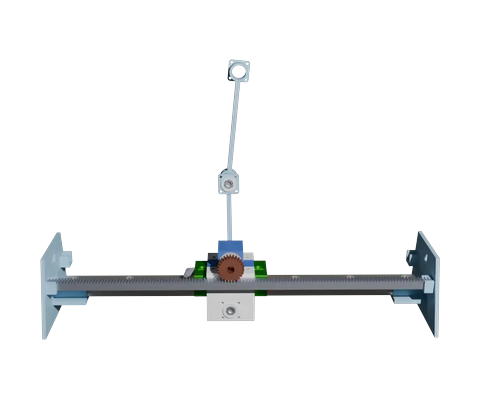</a>
  <a href="https://github.com/darshg321/Spotiplay">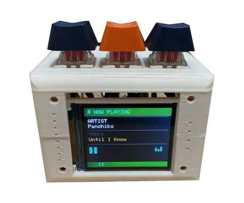</a>

  <a href="https://github.com/darshg321/TopArm">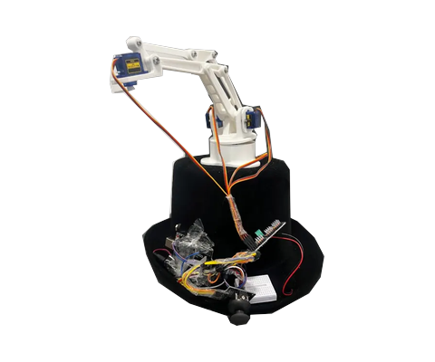</a>
  <a href="https://github.com/darshg321/EasyRP2040">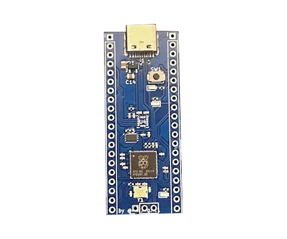</a>
  <a href="https://github.com/darshg321/Mini-Air">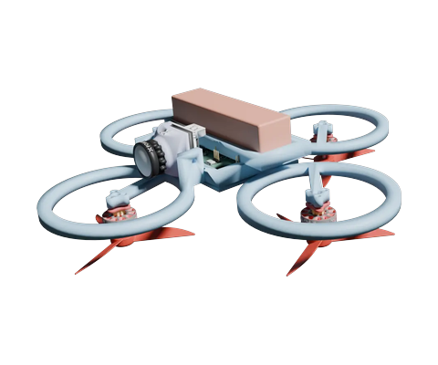</a>
  <a href="https://github.com/darshg321/Boreas">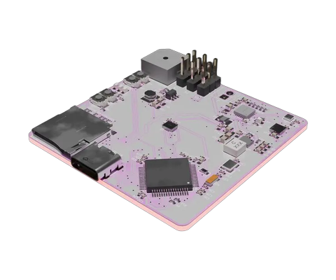</a>
  <a href="https://github.com/darshg321/Fume-Extractor">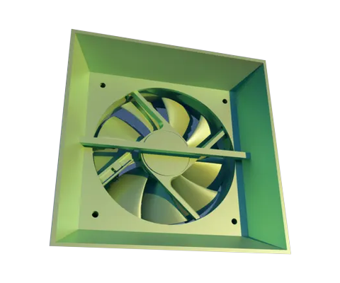</a>

<a href="https://darsh.app">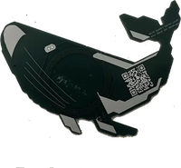</a>

